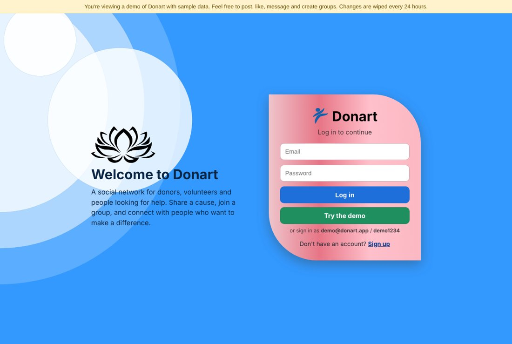
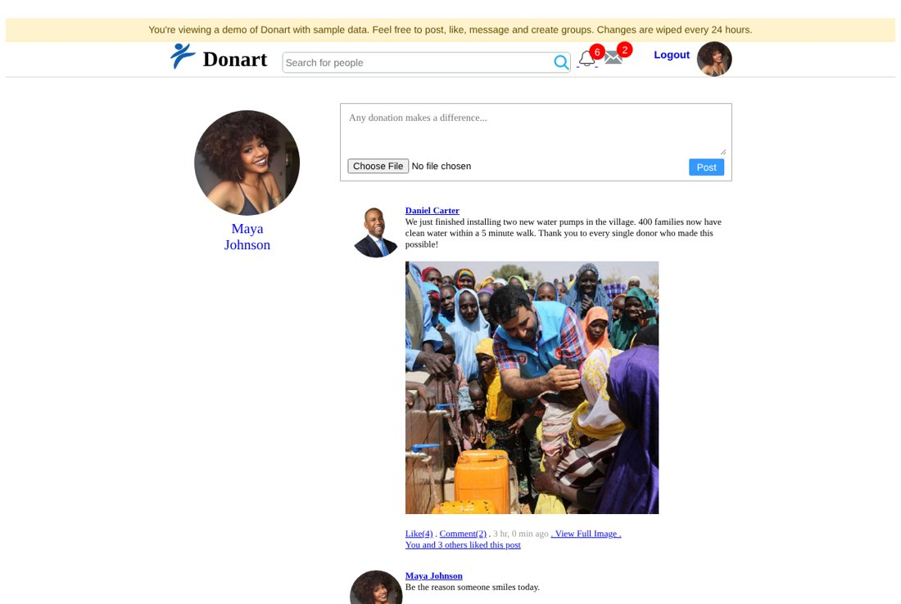
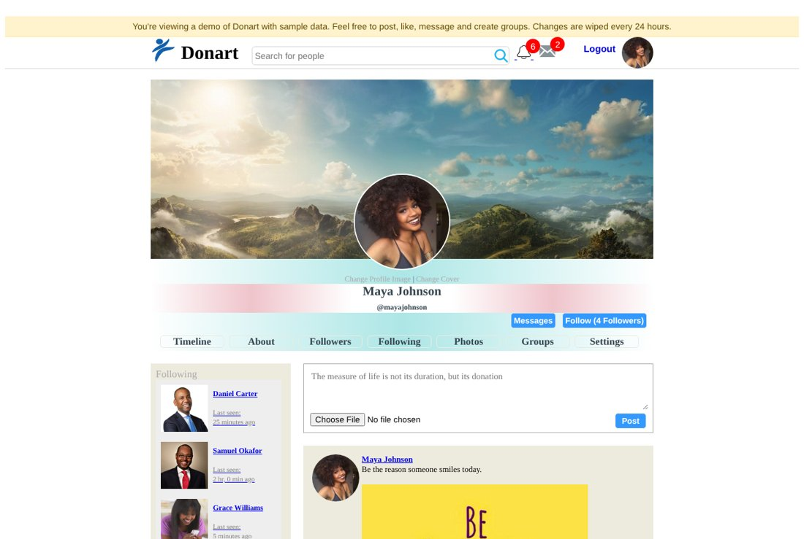
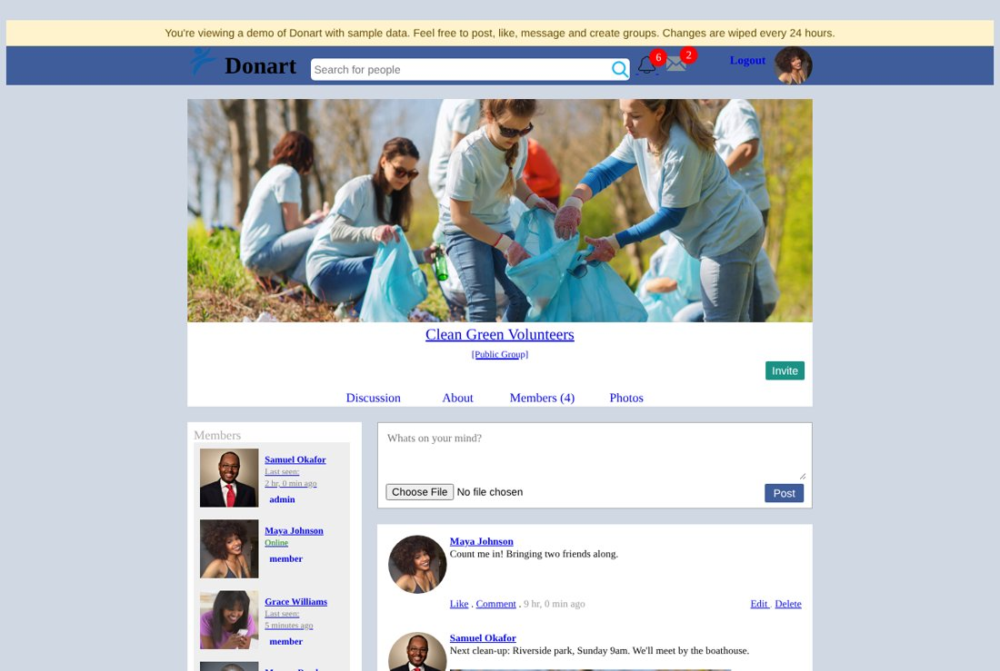
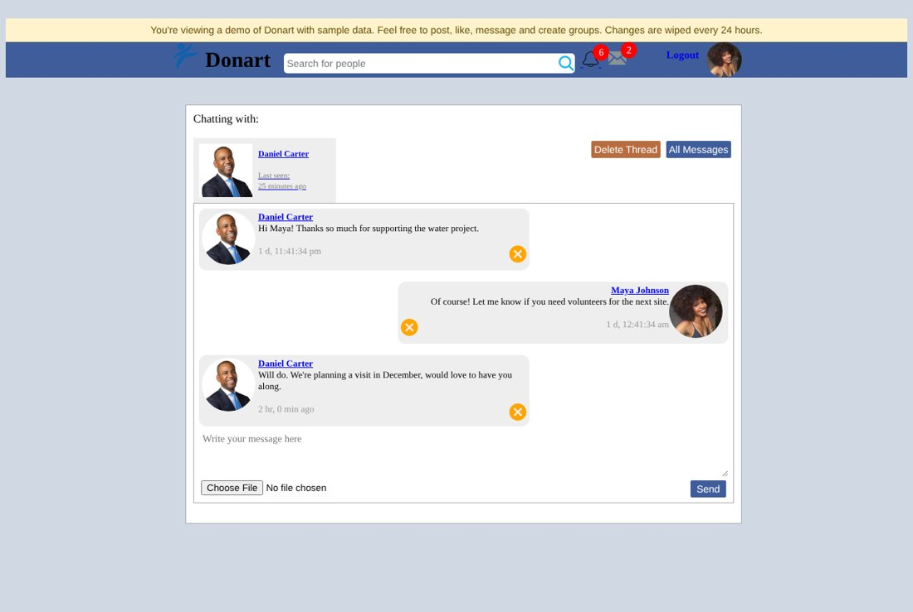

# Donart

Donart is a social network for donors, volunteers and people looking for help. People share causes and updates, follow each other, organise in groups and chat directly.

Built with plain PHP and MySQL/MariaDB, no framework.



## Features

- **Accounts and profiles** with profile and cover photos, an about section, followers and following
- **News feed** of posts from people you follow, with image uploads, likes and comments
- **@mentions** that link to profiles and notify the person tagged
- **Groups** (public or private) with join requests, invites, member roles (admin, moderator, member) and a group discussion feed
- **Direct messages** with photo attachments and unread counts
- **Notifications** for likes, comments, follows, mentions and group activity
- **Search** for people by name

| Feed | Profile |
| --- | --- |
|  |  |
| **Group** | **Messages** |
|  |  |

## Run it with Docker

```bash
docker compose up --build
```

Then open http://localhost:8080 and click **Try the demo**. The database is created and filled with sample users, posts, groups and conversations on first start.

## Demo mode

With `DEMO_MODE=1` (the default in `docker-compose.yml`):

- the login page has a **Try the demo** button that signs you in as Maya Johnson (`demo@donart.app` / `demo1234`)
- a banner tells visitors they're looking at sample data
- the demo account's email and password can't be changed, so it keeps working for the next visitor
- the database and uploaded files reset to the sample data every `DEMO_RESET_HOURS` hours (default 24, set to `0` to turn it off)

Every sample account uses the password `demo1234`, so you can also sign in as `daniel@donart.app`, `samuel@donart.app`, `grace@donart.app` or `marcus@donart.app` to see the other side of a conversation.

## Configuration

| Variable | Default | Purpose |
| --- | --- | --- |
| `DB_HOST` | `localhost` | Database host |
| `DB_PORT` | `3306` | Database port |
| `DB_NAME` | `donart_db` | Database name |
| `DB_USER` | `root` | Database user |
| `DB_PASSWORD` | _(empty)_ | Database password |
| `DEMO_MODE` | off | Turn on the demo features above |
| `DEMO_RESET_HOURS` | `24` | How often demo mode resets the data |
| `APP_DEBUG` | off | Show PHP errors in the page |

## Run it without Docker

You need PHP 8.1+ with the `mysqli` and `gd` extensions, and MySQL 5.7+ or MariaDB 10.3+.

```bash
mysql -u root -e "CREATE DATABASE donart_db"
mysql -u root donart_db < database/schema.sql
mysql -u root donart_db < database/seed.sql     # optional sample data

DEMO_MODE=1 DB_USER=root php -S localhost:8000 router.php
```

Under Apache, point the document root at this folder and enable `mod_rewrite`; the included `.htaccess` handles the clean URLs. The `uploads/` folder must be writable by the web server.

## Project layout

```
classes/        models and helpers (database, users, posts, groups, messages, demo mode)
database/       schema.sql and seed.sql (sample data)
uploads/demo/   images used by the sample data
*.php           one file per page, routed by index.php (/profile/123 loads profile.php)
```
